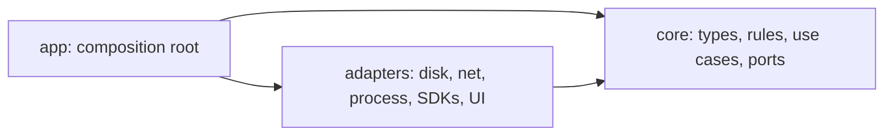

# Architecture style
Shared by every gascoigne repo. A hexagonal layout in the spirit of Chromium: a small core, narrow
interfaces at the edge, and a script that enforces the dependency direction. Sensible size beats
completeness: a small repo needs three zones and two to six ports.

## Zones
- **core**: domain types, state tables, rules and use cases. Standard library and its own packages
  only. It owns the ports it needs.
- **adapters**: filesystem, network, process, clock, provider SDKs, terminal. Each implements a core
  port and has its own wire types, converted to core types at the edge. Adapters never import each other.
- **app** (`cmd/`): reads config, builds adapters, injects them into core. The only place that knows
  both sides.

## What we take from Chromium
- A one-way dependency rule per layer, checked by a script (Chromium's `DEPS` files). The check is the
  architecture: prose alone drifts. See `scripts/check-layers.sh`.
- A core that does not know its embedder.
- Narrow, explicit interfaces at the seams; a public surface per module, everything else internal
  (`internal/` in Go).
- Not taken: many layers, code generation, process separation.

## When a port is justified
A port exists only at a boundary the core cannot control: network, disk, process, clock, randomness,
a third-party SDK, the user interface. It needs a real second implementation, and a test fake counts.
Between two core types there is no interface: call the concrete type.

Shape of a port: owned by core, named for the capability (`PriceSource`, `Clock`), takes and returns
core types, context first, errors wrapped with context. More than about five methods: split it by
what each caller needs.

## Against over-abstraction
No interface for symmetry; no factory for a type with one constructor; no generic repository; no layer
that only forwards calls; no port whose fake no test uses. If the port list outgrows six, run the
`data-model` audit: the cause is usually a missing core type.

## Enforce it
Each repo checks the dependency direction from its check command: a script over a zone list (`scripts/check-layers.sh`) or a test that reads the imports.
